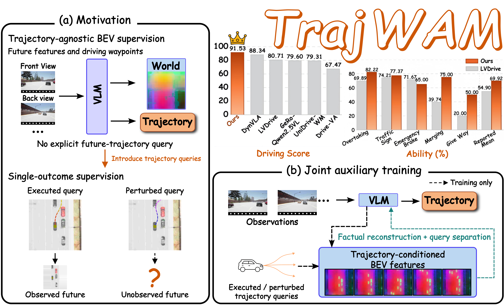
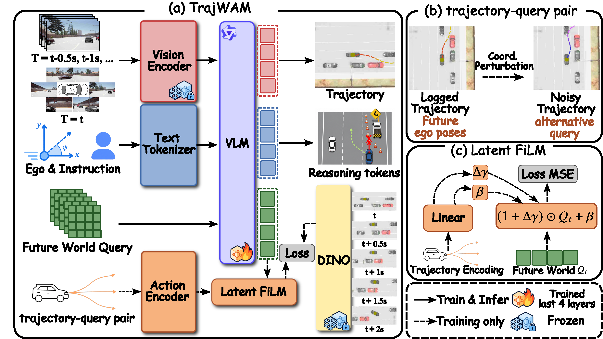
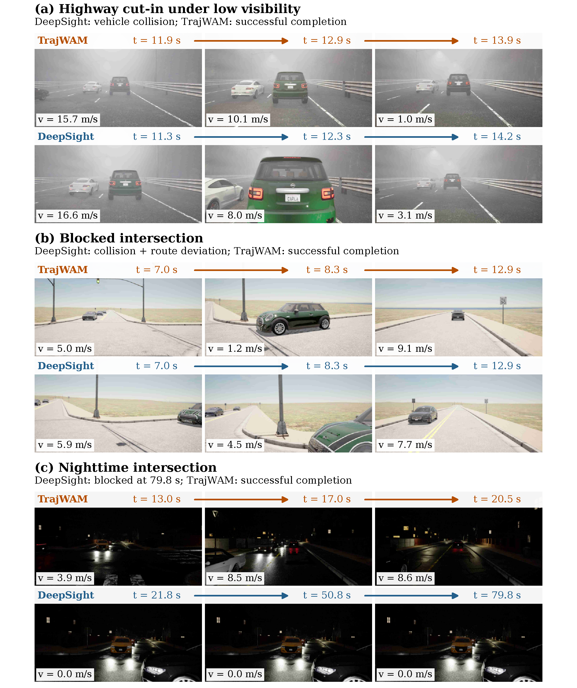

<div align="center">

# TrajWAM

### Trajectory-Conditioned World Action Modeling for Vision–Language Driving

Xuerui Fang<sup>1</sup> · Gulimila Kezierbieke<sup>1,*</sup> · CHEN WANGXING<sup>2</sup> · Hui Li<sup>3,*</sup>

¹ Xinjiang Agricultural University<br>
² ToReality (Hangzhou) Network Technology Co., Ltd.<br>
³ Jiangnan University<br>
\* Corresponding authors

[Overview](#overview) · [Method](#method) · [Results](#results) · [Visualization](#visualization) · [Model download](docs/MODEL_DOWNLOAD.md) · [Evaluation guide](docs/REPRODUCIBILITY.md)

**91.53 Driving Score · 75.45% Success Rate · All 220 Bench2Drive routes**

</div>

## Overview

**TrajWAM improves vision–language driving through trajectory-conditioned auxiliary future learning.** Driving records pair an executed trajectory with an observed future, while alternative trajectories have no corresponding future labels. TrajWAM uses both: factual BEV reconstruction supervises the executed query, and one-sided feature separation encourages a response to a perturbed query. These objectives jointly train the shared driving planner with waypoint supervision.

At deployment, the planner directly generates reasoning and waypoints, followed by PID control. The trajectory-conditioned future-prediction branch is used during training and bypassed during native inference.

[](docs/assets/introduction.png)

*Motivation and overview from the paper. Left: introducing trajectory queries into future supervision creates a single-outcome supervision problem. Lower right: factual reconstruction and query separation train the shared policy. Upper right: reported closed-loop results. Click either figure to view it at full resolution.*

- **Explicit trajectory conditioning:** a four-waypoint ego trajectory conditions future-query states through an ActionEncoder and latent FiLM.
- **Joint auxiliary supervision:** observed futures supervise factual reconstruction; unlabeled perturbed queries provide a one-sided feature-separation objective.
- **Closed-loop planning gains:** on all 220 routes, TrajWAM improves over schedule-matched planning-only fine-tuning by **5.31 DS points and 4.09 SR percentage points**, corresponding to **nine additional successful routes**.

## Method

[](docs/assets/architecture.png)

1. **Shared planner.** A Qwen2.5-VL-3B backbone processes historical front-camera images, current surround views, ego state and route instructions. It generates reasoning and four future waypoints.
2. **Trajectory-conditioned readout.** The ActionEncoder embeds a logged or perturbed four-waypoint trajectory. Latent FiLM modulates the shared future-query states, which are projected into DINOv3-aligned BEV features.
3. **Factual reconstruction and query separation.** A frozen DINOv3 teacher encodes the observed BEV sequence. Reconstruction matches predictions under the executed query to these targets. Separation compares the perturbed prediction with a stop-gradient factual reference. The auxiliary objectives update the trainable shared planner layers alongside reasoning and waypoint supervision.
4. **Native inference.** The VLM generates waypoints directly and the PID controller produces vehicle controls. Fixed future-query tokens remain in the prompt; the ActionEncoder, FiLM and auxiliary readout are bypassed.

## Results

### Closed-loop evaluation on all 220 Bench2Drive routes

The following reproduces **Table 1 of the paper**. Prior-method results are taken from their respective publications. DS is Driving Score; SR is strict Success Rate. Higher is better for all four reported metrics. `*` denotes expert-feature distillation, and the Expert column identifies the expert used by each method.

| Method | Venue | Paradigm | Expert | DS ↑ | SR (%) ↑ | Efficiency ↑ | Smoothness ↑ |
| --- | --- | --- | --- | ---: | ---: | ---: | ---: |
| TCP* | NeurIPS '22 | E2E | Think2Drive | 40.70 | 15.00 | 54.26 | 47.80 |
| ThinkTwice* | CVPR '23 | E2E | Think2Drive | 62.44 | 31.23 | 69.33 | 16.22 |
| DriveAdapter* | ICCV '23 | E2E | Think2Drive | 64.22 | 33.08 | 70.22 | 16.01 |
| VAD | ICCV '23 | E2E | Think2Drive | 42.35 | 15.00 | 157.94 | 46.01 |
| GenAD | ECCV '24 | E2E | Think2Drive | 44.81 | 15.90 | - | - |
| MomAD | CVPR '25 | E2E | Think2Drive | 44.54 | 16.71 | 170.21 | 48.63 |
| DriveTransformer | ICLR '25 | E2E | Think2Drive | 63.46 | 35.01 | 100.64 | 20.78 |
| DiffusionDrive | CVPR '25 | E2E | PDM-Lite | 77.68 | 52.72 | - | - |
| SparseDriveV2 | ECCV '26 | E2E | Think2Drive | 89.15 | 70.00 | 199.84 | 18.32 |
| ReasonPlan | CoRL '25 | VLM | Think2Drive | 64.01 | 34.55 | 180.64 | 25.63 |
| ORION | ICCV '25 | VLM | Think2Drive | 77.74 | 54.62 | 151.48 | 17.38 |
| SimLingo | CVPR '25 | VLM | PDM-Lite | 85.94 | 66.82 | 244.18 | 25.49 |
| AutoVLA | NeurIPS '25 | VLM | Think2Drive | 78.84 | 57.73 | 146.93 | 39.33 |
| DeepSight | ICML '26 | VLM | Think2Drive | 86.23 | 71.36 | 201.71 | 16.11 |
| UniDrive-WM | ECCV '26 | WM | Think2Drive | 79.31 | 56.42 | 158.65 | 27.93 |
| GeRo-Qwen2.5VL | CVPR '26 | WM | Think2Drive | 79.60 | 57.80 | 159.66 | 44.75 |
| DynVLA | ICML '26 | WM | Think2Drive | 88.34 | 72.73 | - | - |
| LVDrive | arXiv '26 | WAM | Think2Drive | 80.71 | 58.26 | 155.77 | 14.34 |
| **TrajWAM (Ours)** | This work | WAM | Think2Drive | **91.53** | **75.45** | 171.41 | 15.27 |

TrajWAM has the highest DS and SR among the methods listed in this table: **+2.38 DS** over SparseDriveV2 and **+2.72 SR percentage points** over DynVLA.

### Multi-ability evaluation

**Table 2 of the paper.** Scores are percentages; higher is better. The table reports five driving abilities and their reported mean. Bold values mark the highest score in each ability column. Venue and expert-feature distillation (`*`) follow Table 1.

| Method | Venue | Paradigm | Merging ↑ | Overtaking ↑ | Emergency Brake ↑ | Give Way ↑ | Traffic Sign ↑ | Mean ↑ |
| --- | --- | --- | ---: | ---: | ---: | ---: | ---: | ---: |
| TCP* | NeurIPS '22 | E2E | 16.18 | 20.00 | 20.00 | 10.00 | 6.99 | 14.63 |
| ThinkTwice* | CVPR '23 | E2E | 27.38 | 18.42 | 35.82 | **50.00** | 54.23 | 37.17 |
| DriveAdapter* | ICCV '23 | E2E | 28.82 | 26.38 | 48.76 | **50.00** | 56.43 | 42.08 |
| AD-MLP | arXiv '23 | E2E | 0.00 | 0.00 | 0.00 | 0.00 | 4.35 | 0.87 |
| UniAD-Base | CVPR '23 | E2E | 14.10 | 17.78 | 21.67 | 10.00 | 14.21 | 15.55 |
| VAD | ICCV '23 | E2E | 8.11 | 24.44 | 18.64 | 20.00 | 19.15 | 18.07 |
| DriveTransformer | ICLR '25 | E2E | 17.57 | 35.00 | 48.36 | 40.00 | 52.10 | 38.60 |
| SparseDriveV2 | ECCV '26 | E2E | 66.25 | 75.55 | 75.00 | **50.00** | 71.57 | 67.67 |
| ReasonPlan | CoRL '25 | VLM | 37.50 | 26.67 | 33.30 | 40.00 | 45.79 | 36.66 |
| ORION | ICCV '25 | VLM | 25.00 | 71.11 | 78.33 | 30.00 | 69.15 | 54.72 |
| SimLingo | CVPR '25 | VLM | 60.00 | 60.00 | 78.33 | **50.00** | **77.89** | 65.25 |
| DeepSight | ICML '26 | VLM | 60.00 | **91.11** | 78.33 | **50.00** | 71.58 | **70.20** |
| UniDrive-WM | ECCV '26 | WM | 29.97 | 74.64 | 79.98 | 40.00 | 71.54 | 59.23 |
| GeRo-Qwen2.5VL | CVPR '26 | WM | 37.83 | 72.81 | **83.10** | **50.00** | 66.17 | 61.98 |
| LVDrive | arXiv '26 | WAM | 39.74 | 69.89 | 71.67 | 20.00 | 74.21 | 54.90 |
| **TrajWAM (Ours)** | This work | WAM | **75.00** | 82.22 | 65.00 | **50.00** | 77.37 | 69.92 |

TrajWAM achieves **75.00% Merging** and **50.00% Give Way**, the highest and joint-highest scores in the table. It ranks second in Overtaking (**82.22%**), Traffic Sign (**77.37%**) and mean ability (**69.92%**).

## Visualization

### Closed-loop driving: TrajWAM and DeepSight

The three cases below compare TrajWAM with DeepSight under matching route, scenario and weather configurations. **TrajWAM is the upper row and DeepSight is the lower row in each case.** Arrows indicate chronological order; timestamps and speeds are shown in the figure.

[](docs/assets/closed_loop_comparison.png)

TrajWAM completes all three selected routes successfully. The recorded DeepSight outcomes are **(a) vehicle collision**, **(b) collision and route deviation**, and **(c) blocked-agent termination**. The panels show nearby ego positions in (a), equal elapsed times in (b), and independent time sequences in (c) to illustrate progression versus persistent standstill. Click the figure to inspect the full-resolution frames and timeline.

## Code and checkpoint

This release provides the **closed-loop evaluation runtime**: checkpoint loading, the driving agent, benchmark scenarios, single- and multi-GPU launchers, and score aggregation. Training and auxiliary prediction entry points are outside this evaluation release.

| Resource | Location |
| --- | --- |
| Environment, simulator and evaluation instructions | [Reproduction guide](docs/REPRODUCIBILITY.md) |
| Trained checkpoint | [Baidu Netdisk](https://pan.baidu.com/s/10GRbfS7DTxYw7yINi5rpQw?pwd=1234), extraction code **1234** |
| Checkpoint preparation and verification | [Download instructions](docs/MODEL_DOWNLOAD.md) |
| Model details and intended use | [Model card](docs/MODEL_CARD.md) |
| Training dataset resources | [Official Bench2Drive repository](https://github.com/Thinklab-SJTU/Bench2Drive#dataset) |

Extract `TrajWAM-v1.0.0.zip` and use the complete `TrajWAM-v1.0.0/` directory, including both safetensors shards and all configuration, tokenizer and processor files. The reproduction guide includes integrity checks and model-loading checks.

## Quick start

### 1. Set up the environment

```bash
git clone https://github.com/FangWD520/TrajWAM.git
cd TrajWAM
```

Follow the [environment setup](docs/REPRODUCIBILITY.md#1-environment-and-simulator) for Linux, CARLA **0.9.16**, its town assets, and the Python dependencies. The supplied runtime uses PyTorch **2.7.1**, CUDA **12.8**, and Transformers **4.56.0**. Each evaluation worker runs one planner and one CARLA instance on its GPU.

### 2. Download and check the checkpoint

Follow the [model download instructions](docs/MODEL_DOWNLOAD.md), then check the extracted directory:

```bash
python scripts/check_environment.py \
  --checkpoint /absolute/path/to/TrajWAM-v1.0.0 \
  --files-only
```

### 3. Run closed-loop evaluation

After environment and simulator setup, launch evaluation on four GPUs:

```bash
python scripts/evaluate_multigpu.py \
  --gpus 0,1,2,3 \
  --checkpoint /absolute/path/to/TrajWAM-v1.0.0 \
  --output /absolute/path/to/results/trajwam220
```

Use `--gpus 0` to evaluate the same 220 routes serially on one GPU. Add `--dry-run` to inspect route assignment before launching, or `--resume` to continue an interrupted run using the same output directory and shard configuration.

Closed-loop evaluation obtains its observations from CARLA; the training dataset is not required for this step. The launcher aggregates route records into `merged.json` and writes DS and SR to `summary.json`. See the [evaluation guide](docs/REPRODUCIBILITY.md) for manual aggregation, ability metrics and troubleshooting.

## Repository layout

```text
assets/              Historical-image placeholder used by the runtime
bench2drive/         Route XML, scenarios, evaluator, agent, PID and scoring
scripts/             Setup, checkpoint checks, launch and score aggregation
src/wam/             Checkpoint-compatible modules and native loading
src/transformers/    Version-locked model runtime patch
docs/                Reproduction guide, model card and checkpoint instructions
docs/assets/         Paper figures displayed on this page
licenses/            Upstream model license terms
```

## Citation

```bibtex
@misc{fang2026trajwam,
  title  = {TrajWAM: Trajectory-Conditioned World Action Modeling for Vision--Language Driving},
  author = {Fang, Xuerui and Kezierbieke, Gulimila and {CHEN WANGXING} and Li, Hui},
  year   = {2026},
  url    = {https://github.com/FangWD520/TrajWAM}
}
```

## Acknowledgments and licenses

Built with Qwen. This code builds on DeepSight, Transformers, Bench2Drive and CARLA. See [THIRD_PARTY_NOTICES.md](THIRD_PARTY_NOTICES.md) for upstream attribution and code licenses. The checkpoint is distributed under the applicable [Qwen Research License](licenses/QWEN_RESEARCH_LICENSE.txt) and [DINOv3 License](licenses/DINOV3_LICENSE.md); the code license does not replace these model terms.

## Contact

Corresponding authors: Gulimila Kezierbieke ([glml@xjau.edu.cn](mailto:glml@xjau.edu.cn)) and Hui Li ([lihui.cv@jiangnan.edu.cn](mailto:lihui.cv@jiangnan.edu.cn)).
